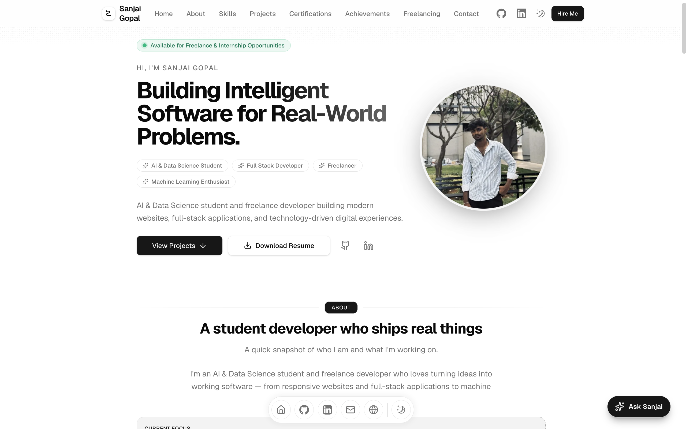

<div align="center">

# Sanjai — Portfolio

### Modern personal portfolio built with Next.js, Magic UI, and Framer Motion.

[](https://www.sanjaibuilds.cv/)

</div>

---

## Preview



---

## ✦ About the Website

A modern, responsive personal portfolio designed to showcase projects, skills, certifications, achievements, freelance services, and an AI-powered portfolio assistant (**Ask Sanjai**) through a sleek, interactive user experience.

---

## ✨ Features

- Modern responsive design with Tailwind CSS
- Light / dark theme toggle with system preference support
- Magic UI components & smooth micro-interactions
- Framer Motion animation effects
- Interactive project showcase (Swasthya Sathi AI, AQI24, HackHub, Forge, and more)
- Interactive certification & achievement previews with image/PDF modal viewer
- Freelance services & direct booking CTA
- Verifiable resume download
- Full GitHub, LinkedIn, and email integration
- **Ask Sanjai** streaming AI chatbot with smart topic guardrails
- Performance & SEO optimized with OpenGraph and dynamic JSON-LD

---

## 🛠 Tech Stack

`Next.js (App Router)` · `React` · `TypeScript` · `Tailwind CSS`  
`Magic UI` · `shadcn/ui` · `Framer Motion`  
`Vercel` · `Hugging Face / Gemini`

---

## 🚀 Run Locally

```bash
git clone https://github.com/Sanjai-Gopal/sanjai.dev.git
cd sanjai.dev
npm install
npm run dev
```
